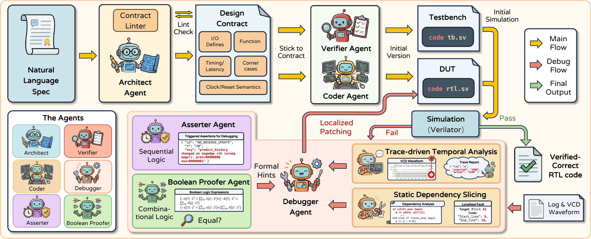

<div align="center">

# [NeurIPS 2026] Veri-Sure: Multi-Agent RTL Code Generation with Temporal Tracing, Slicing and Formal Verification

**Jiale Liu**<sup>1</sup>, **Taiyu Zhou**<sup>2</sup>, **Tianqi Jiang**<sup>3</sup>

<sup>1</sup>The University of Edinburgh &nbsp;&nbsp; <sup>2</sup>University of Macau &nbsp;&nbsp; <sup>3</sup>CUHK, Shenzhen

[](https://arxiv.org/abs/2601.19747)
[](https://neurips.cc/Conferences/2026)
[](benchmarks/verilogeval-v2-ext)
[](https://www.python.org/)
[](LICENSE)
[](https://github.com/xyjoey/Veri-Sure)

</div>

<p align="center">
  
</p>

## 📢 News

- 🎉 **Veri-Sure** has been accepted to **NeurIPS 2026**!
- 💻 We release the code and the **VerilogEval-v2-EXT** benchmark.
- 📄 The paper is released on [arXiv](https://arxiv.org/abs/2601.19747).

## 📖 Overview

Writing RTL is different from writing software: hardware description languages describe concurrent behavior with strict cycle-level timing. LLM-based RTL generation is therefore held back by **(i)** sparse feedback and limited test coverage from simulation-only evaluation, **(ii)** regressions and repair hallucinations from regenerating the whole file during debugging, and **(iii)** semantic drift as intent is reinterpreted across repair iterations and agent handoffs.

**Veri-Sure** is a multi-agent framework. It turns the natural-language spec into a **design contract** that every agent follows, debugs failures with **trace-driven temporal analysis** and **static dependency slicing** so that the Debugger makes small, **localized patches**, and adds **formal verification** (assertions and Boolean equivalence proofs) to the debugging loop. We also introduce **VerilogEval-v2-EXT**, which extends VerilogEval-v2 with 53 industrial-grade tasks and Easy/Medium/Hard difficulty levels. With GPT-5.2, Veri-Sure reaches **93.30%** functional Pass@1, ahead of standalone LLMs and prior agentic systems.

## ✨ Highlights

- 📝 **Design contract.** The Architect turns the spec into a linted JSON contract (interface, clock/reset semantics, per-output latency, functional summary, corner cases), the single source of truth shared by all agents.
- 🔍 **Trace-driven temporal analysis.** From the simulation log and VCD waveform we find the first failing time and signals, extract a short waveform window, and detect off-by-one-cycle and wrong-edge bugs with an alignment check.
- ✂️ **Static slicing & localized patching.** A tree-sitter dependency slice narrows a failure to a few suspect RTL blocks. The Debugger may only edit those blocks, and any patch that does not improve the failure is rolled back. A patch changes **7.9 lines** on average, versus 68.8 lines for whole-file regeneration.
- 🧪 **Formal verification.** An **Asserter** binds contract-derived SystemVerilog assertions to the DUT, and a **Boolean Proofer** proves combinational outputs against a contract-derived reference model with a SymbiYosys miter. Both feed hints to the Debugger.
- 📊 **VerilogEval-v2-EXT.** 209 problems (156 original + 53 new) covering arithmetic, communication protocols, FIFOs/CDC, DSP and system control, split into Easy (51), Medium (91) and Hard (67).

## 🏆 Main Results

**Pass@1 (%) on VerilogEval-v2-EXT.** Syntax success means the RTL compiles in Verilator; functional success means it passes the golden testbench. Following MAGE, the golden testbench is given to the Architect and Verifier as optional context and is also the final pass condition.

**Rankings**: 🥇 Global 1st, 🥈 Global 2nd, 🥉 Global 3rd (across all methods). 👍 Group Best (if not in the global top 3).

**Badges**: 🏆 Best Open-Weight (top open-weight model), 🚀 High Potential (largest relative gain with agents), ⚡️ Efficiency King (best performance-to-parameter ratio), 🧠 Reasoning Expert (best on the Hard subset), 💪 Robust Performer (smallest gap between Syntax and Functional scores).

| Method | Params | Easy (n=51)<br>Syn. / Func. | Medium (n=91)<br>Syn. / Func. | Hard (n=67)<br>Syn. / Func. | Overall<br>Syn. / Func. |
|--------|--------|-----------------------------|-----------------------------|---------------------------|------------------------|
| **Standalone LLMs** ||||||
| GPT-5.2 | - | 🥇 100.00 / 🥉 94.12 | 🥇 100.00 / 79.12 | 🥇 100.00 / 59.70 | 🥇 100.00 / 76.56 |
| Claude-4.5-Sonnet | - | 🥇 100.00 / 90.20 | 🥇 100.00 / 74.73 | 🥉 97.01 / 53.73 | 🥉 99.04 / 71.77 |
| Gemini-3-Pro 🧠 | - | 🥇 100.00 / 🥉 94.12 | 🥇 100.00 / 👍 85.71 | 🥇 100.00 / 👍 62.69 | 🥇 100.00 / 👍 80.38 |
| Qwen3-Max | - | 🥉 96.08 / 86.27 | 93.41 / 54.95 | 86.57 / 37.31 | 91.87 / 56.94 |
| Mistral-Medium-3.1 | - | 🥇 100.00 / 78.43 | 87.91 / 52.75 | 77.61 / 19.40 | 87.56 / 48.33 |
| DeepSeek-3.2 | 685B (37B) | 🥉 96.08 / 80.39 | 96.70 / 64.84 | 85.07 / 41.79 | 92.82 / 61.24 |
| Qwen3-Coder-Plus | 480B (35B) | 92.16 / 80.39 | 91.21 / 60.44 | 77.61 / 29.85 | 87.08 / 55.50 |
| LLaMA-4-Maverick | 402B (17B) | 🥇 100.00 / 86.27 | 85.71 / 53.85 | 76.12 / 32.84 | 86.12 / 55.02 |
| GLM-4.7 🏆 💪 | 358B (32B) | 🥉 96.08 / 90.20 | 86.81 / 70.33 | 71.64 / 44.78 | 84.21 / 66.99 |
| Devstral-2 | 123B | 🥈 98.04 / 80.39 | 91.21 / 58.24 | 67.16 / 25.37 | 85.17 / 53.11 |
| Ministral-3-14B 🚀 | 14B | 94.12 / 70.59 | 71.43 / 29.67 | 55.22 / 11.94 | 71.77 / 33.97 |
| QiMeng-SALV | 7B | 🥉 96.08 / 66.67 | 95.60 / 53.85 | 88.06 / 22.39 | 93.30 / 46.89 |
| RTL-Coder | 6.7B | 94.12 / 64.71 | 83.52 / 29.67 | 65.67 / 5.97 | 80.38 / 30.62 |
| CodeV-R1 ⚡️ | 7B | 88.24 / 74.51 | 92.31 / 54.95 | 64.18 / 23.88 | 82.30 / 49.76 |
| VeriLogos | 7B | 86.27 / 49.02 | 90.11 / 26.37 | 71.64 / 1.49 | 83.25 / 23.92 |
| **Single-Agent Systems** (w. Simulator Feedback & Iterative Fix) ||||||
| w. GPT-5.2 | - | 🥇 100.00 / 🥈 96.08 | 🥇 100.00 / 81.32 | 🥇 100.00 / 59.70 | 🥇 100.00 / 77.99 |
| w. Gemini-3-Pro | - | 🥇 100.00 / 🥈 96.08 | 🥇 100.00 / 🥉 86.81 | 🥇 100.00 / 🥉 70.15 | 🥇 100.00 / 👍 83.73 |
| w. Qwen3-Max | - | 🥇 100.00 / 🥉 94.12 | 92.31 / 68.13 | 89.55 / 44.78 | 93.30 / 66.99 |
| w. Mistral-Medium-3.1 | - | 🥈 98.04 / 78.43 | 95.60 / 56.04 | 89.55 / 31.34 | 94.26 / 53.59 |
| w. DeepSeek-3.2 | 685B (37B) | 🥇 100.00 / 84.31 | 🥉 97.80 / 67.03 | 94.03 / 44.78 | 97.13 / 64.11 |
| w. Qwen3-Coder-Plus | 480B (35B) | 🥈 98.04 / 80.39 | 93.41 / 63.74 | 88.06 / 31.34 | 92.82 / 57.42 |
| w. LLaMA-4-Maverick | 402B (17B) | 🥇 100.00 / 92.16 | 91.21 / 59.34 | 79.10 / 32.84 | 89.47 / 58.85 |
| w. GLM-4.7 | 358B (32B) | 🥈 98.04 / 🥉 94.12 | 96.70 / 81.32 | 92.54 / 58.21 | 95.69 / 77.03 |
| w. Devstral-2 | 123B | 🥇 100.00 / 78.43 | 94.51 / 57.14 | 88.06 / 34.33 | 93.78 / 55.02 |
| w. Ministral-3-14B | 14B | 94.12 / 76.47 | 79.12 / 48.35 | 55.22 / 19.40 | 75.12 / 45.93 |
| w. QiMeng-SALV | 7B | 🥈 98.04 / 74.51 | 94.51 / 51.65 | 88.06 / 17.91 | 93.30 / 46.41 |
| w. RTL-Coder | 6.7B | 84.31 / 56.86 | 80.22 / 38.46 | 70.15 / 8.96 | 77.99 / 33.49 |
| w. CodeV-R1 | 7B | 🥈 98.04 / 84.31 | 🥉 97.80 / 61.54 | 85.07 / 32.84 | 93.78 / 57.89 |
| w. VeriLogos | 7B | 🥉 96.08 / 56.86 | 86.81 / 24.18 | 82.09 / 4.48 | 87.56 / 25.84 |
| **Multi-Agent Systems** ||||||
| MAGE (w. GPT-5.2) | - | 🥇 100.00 / 🥈 96.08 | 🥇 100.00 / 🥇 95.60 | 🥈 98.51 / 🥈 77.61 | 🥈 99.52 / 🥈 89.95 |
| VerilogCoder (w. GPT-5.2) | - | 🥇 100.00 / 🥉 94.12 | 🥇 100.00 / 🥈 90.11 | 🥇 100.00 / 68.66 | 🥇 100.00 / 🥉 84.21 |
| Veri-Sure (w. DeepSeek-3.2) | 685B (37B) | 🥇 100.00 / 90.20 | 🥈 98.90 / 73.63 | 🥉 97.01 / 53.73 | 98.56 / 71.29 |
| **Veri-Sure (w. GPT-5.2)** | - | 🥇 **100.00** / 🥇 **100.00** | 🥇 **100.00** / 🥇 **95.60** | 🥇 **100.00** / 🥇 **85.07** | 🥇 **100.00** / 🥇 **93.30** |

Params lists total (active) parameters for MoE models and total parameters for dense models.

## 📦 The VerilogEval-v2-EXT Benchmark

VerilogEval-v2 is dominated by short, textbook-style modules. VerilogEval-v2-EXT keeps its 156 problems and evaluation protocol and adds **53 industrial-grade tasks** in five categories that the original set lacks:

| Category | Examples of what is tested |
|----------|----------------------------|
| Advanced Arithmetic & Math | Multi-operator datapaths, overflow/saturation, defined latency |
| Standard Communication Protocols | Framing/encoding, CRC/parity, start/stop conditions, valid-ready handshakes |
| Memory, CDC & Flow Control | FIFO logic, full/empty semantics, backpressure, safe control signaling |
| DSP & Image Processing | Windowed/streaming computation, pipeline alignment, boundary handling |
| Advanced Timing & System Control | Multi-stage pipelines, coordinated enables, FSM + datapath interaction |

All 209 problems are labeled **Easy (51) / Medium (91) / Hard (67)** by a rule-based complexity score (lines of code, `assign`/`always`/`case` counts and maximum bit width), checked by hand. The full lists and scoring rules are in Appendix A of the paper. We also fixed the `Prob099` testbench, whose port names did not match the reference module and failed to elaborate in Verilator (Appendix A.4).

Each problem in [`benchmarks/verilogeval-v2-ext/dataset_spec-to-rtl`](benchmarks/verilogeval-v2-ext/dataset_spec-to-rtl) has three files:

```text
ProbXXX_<name>_prompt.txt   # natural-language specification
ProbXXX_<name>_ref.sv       # reference implementation (module RefModule)
ProbXXX_<name>_test.sv      # golden testbench (instantiates RefModule and TopModule)
```

## 🛠️ Installation

### 1. Python environment

```bash
git clone https://github.com/xyjoey/Veri-Sure.git
cd Veri-Sure

conda create -n veri-sure python=3.10 -y
conda activate veri-sure
pip install -r requirements.txt
```

### 2. EDA toolchain

| Tool | Used for | Required? |
|------|----------|-----------|
| [Verilator](https://github.com/verilator/verilator) 5.x | Syntax checks, simulation, assertions | ✅ Required |
| [Yosys](https://github.com/YosysHQ/yosys) + [SymbiYosys](https://github.com/YosysHQ/sby) | Boolean Proofer (miter proofs) | Recommended |
| [Z3](https://github.com/Z3Prover/z3) | SMT backend for SymbiYosys | Recommended |

Without Yosys, SymbiYosys and Z3, Veri-Sure still runs, but the Boolean Proofer cannot prove anything and only reports the missing toolchain to the Debugger. The [OSS CAD Suite](https://github.com/YosysHQ/oss-cad-suite-build) bundles prebuilt Verilator, Yosys and SymbiYosys. Check your installation with:

```bash
verilator --version   # tested with Verilator 5.044
yosys -V
sby --version
z3 --version
```

> [!NOTE]
> Verilator cannot build in directories whose path contains spaces, so keep the repository and the output folder (`runs/` by default) on a path without spaces.

### 3. LLM endpoint

Veri-Sure supports **OpenAI** (and any OpenAI-compatible server, such as DeepSeek or vLLM), **Anthropic** and **Google Gemini**. Copy the template and fill in the provider you use:

```bash
cp .env.example .env
```

```dotenv
LLM_PROVIDER=anthropic
ANTHROPIC_API_KEY=...
ANTHROPIC_MODEL=claude-opus-5-5
```

| Provider | `LLM_PROVIDER` | API key | Model (default) | Custom endpoint |
|----------|----------------|---------|-----------------|-----------------|
| OpenAI / OpenAI-compatible | `openai` | `OPENAI_API_KEY` | `OPENAI_MODEL` (`gpt-5.2`) | `OPENAI_BASE_URL` |
| Anthropic | `anthropic` | `ANTHROPIC_API_KEY` | `ANTHROPIC_MODEL` (`claude-opus-5-5`) | `ANTHROPIC_BASE_URL` |
| Google Gemini | `gemini` | `GEMINI_API_KEY` or `GOOGLE_API_KEY` | `GEMINI_MODEL` (`gemini-4-argon`) | `GEMINI_BASE_URL` |

Settings are resolved in this order: command-line flags (`--provider`, `--model`, `--api-key`, `--base-url`) first, then your shell environment, then `.env`. Veri-Sure looks for `.env` in the current directory (or a parent) and then in the repository root; use `--env-file` to point elsewhere. `.env` is git-ignored, so your keys stay out of the repository.

Request defaults follow each provider:

- **OpenAI:** temperature 0, top_p 1, at most 4096 output tokens.
- **Anthropic:** no `temperature`/`top_p` (current Claude models reject them), at most 16000 output tokens, `effort: high` on Claude Opus 5.5, and server-side refusal fallbacks on the Claude API (set `ANTHROPIC_FALLBACKS=off` to disable them).
- **Gemini:** the API's own defaults.

`--reasoning-effort` sets OpenAI's `reasoning_effort`, Claude's effort level, or Gemini's `thinking_level`.

## 🚀 Quick Start

Generate RTL from a natural-language spec:

```bash
python -m eda_agent run \
  --prompt "Implement a 4-bit adder with inputs a[3:0], b[3:0], and output sum[4:0]"

# Same, with a different provider than the one in .env
python -m eda_agent run --provider gemini \
  --prompt "Implement a 4-bit adder with inputs a[3:0], b[3:0], and output sum[4:0]"
```

Run a single benchmark problem against its golden testbench:

```bash
P=benchmarks/verilogeval-v2-ext/dataset_spec-to-rtl/Prob031_dff
python -m eda_agent run \
  --prompt "$(cat ${P}_prompt.txt)" \
  --golden-tb ${P}_test.sv \
  --golden-ref ${P}_ref.sv
```

The command prints `PASS` or `FAIL` (exit code 0 or 2) and the path of the run directory. Each run in `runs/` keeps every intermediate artifact:

| File | Content |
|------|---------|
| `contract.json`, `contract_lint.txt` | Design contract and its lint report |
| `tb.sv`, `if.sv`, `rtl.sv` | Testbench, module interface and final RTL |
| `wave.vcd`, `trace_report.json` | Waveform and trace-driven bug report |
| `asserter/`, `boolean_proof/` | Formal-verification artifacts and reports |
| `*_prompt.txt`, `*_raw_output.txt` | Prompts sent to and raw replies from each agent |

Other useful options: `--provider`, `--model`, `--base-url`, `--env-file`, `--reasoning-effort`, `--temperature`, `--top-p`, `--max-tokens`, `--stream`, `--sim-max-retry`, `--debug-max-trials`, `--runs-root`, and `--ablation` (Coder only: standalone generation from the spec with syntax-check retries, with no contract, testbench or debugging). See `python -m eda_agent run --help` for the full list.

## 📊 Evaluation on VerilogEval-v2-EXT

```bash
# Full benchmark (209 problems)
python benchmarks/run_verilog_eval_v2.py --samples 1 --jobs 4

# A single problem, or the first N problems
python benchmarks/run_verilog_eval_v2.py --problem Prob031_dff
python benchmarks/run_verilog_eval_v2.py --limit 10

# Override the provider from .env for one run
python benchmarks/run_verilog_eval_v2.py --provider anthropic --limit 10
```

Results are written to `runs/verilog-eval-v2/` by default (`--out-root` to change). See `python benchmarks/run_verilog_eval_v2.py --help` for all options.

> [!WARNING]
> **API cost.** Running Veri-Sure on all 209 problems can be very expensive, please keep track of your API usage. We recommend running a small subset first to verify your setup.

## 📝 Citation

If you find Veri-Sure or VerilogEval-v2-EXT useful, please cite our paper:

```bibtex
@misc{liu2026verisure,
  title         = {{Veri-Sure}: Multi-Agent {RTL} Code Generation with Temporal Tracing, Slicing and Formal Verification},
  author        = {Liu, Jiale and Zhou, Taiyu and Jiang, Tianqi},
  year          = {2026},
  eprint        = {2601.19747},
  archivePrefix = {arXiv},
  primaryClass  = {cs.AR},
  url           = {https://arxiv.org/abs/2601.19747}
}
```

## 🙏 Acknowledgements

VerilogEval-v2-EXT builds on [VerilogEval](https://github.com/NVlabs/verilog-eval), and some prompts are adapted from [VerilogCoder](https://arxiv.org/abs/2408.08927); our evaluation protocol follows [MAGE](https://github.com/stable-lab/MAGE). Veri-Sure is built on [AgentScope](https://github.com/agentscope-ai/agentscope), [Verilator](https://verilator.org), [Yosys](https://github.com/YosysHQ/yosys), [SymbiYosys](https://github.com/YosysHQ/sby), [Z3](https://github.com/Z3Prover/z3) and [tree-sitter-verilog](https://github.com/tree-sitter/tree-sitter-verilog). 

We thank the University of Edinburgh's ELM service and EDINA team for supporting API access. This work also used the Isambard-AI National AI Research Resource (AIRR), operated by the University of Bristol and funded by the UK Government's Department for Science, Innovation and Technology (DSIT) via UK Research and Innovation, and by the Science and Technology Facilities Council [ST/AIRR/I-A-I/1023].

## 📄 License

This project is released under the [MIT License](LICENSE). It includes code from [verilog-eval](https://github.com/NVlabs/verilog-eval) and [human-eval](https://github.com/openai/human-eval), both MIT-licensed.